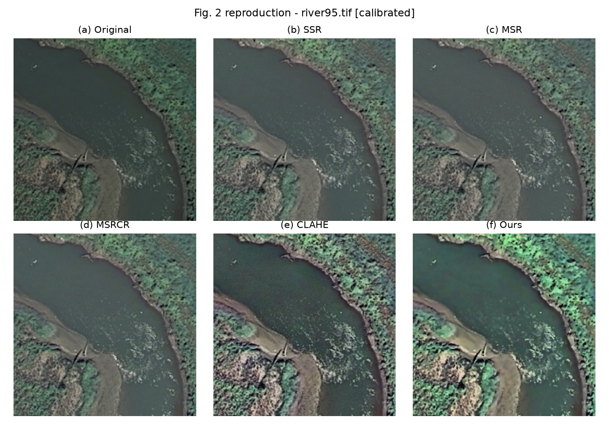
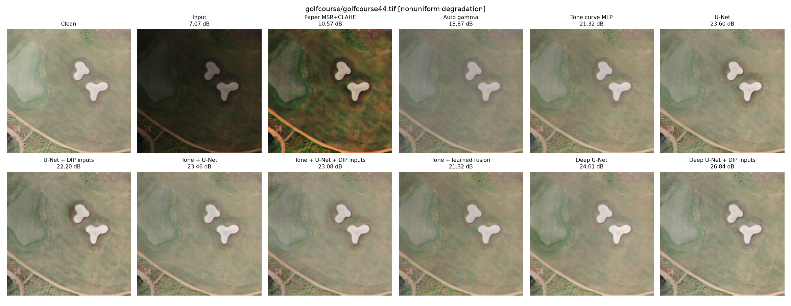

# Enhancing aerial images: classical image processing and machine learning

This project takes a published method for improving the look of aerial photographs, checks
whether its reported results can be reproduced, and then tests whether machine learning can do
better. It was done as a Digital Image Processing course project.

In one paragraph: the published method could only be partly reproduced, and some of its reported
numbers turn out to be impossible. When the task is restated so that quality can be measured
fairly, the classical methods do poorly on their own, but they become useful when their outputs
are handed to a neural network as extra information. The best result comes from that
combination.

## The problem

Aerial and satellite photographs are often dark, hazy or flat-looking. Image enhancement tries to
make them clearer: brighter shadows, stronger contrast, more visible detail.

The starting point is this paper:

> Meng et al., "Remote Sensing Image Enhancement Based on MSR and CLAHE", WCSE 2022,
> doi:10.18178/wcse.2022.04.059.

The images come from the UC Merced Land Use dataset: 2,100 aerial photographs of 256 x 256
pixels, 100 each of 21 kinds of scene such as beaches, rivers, forests and airports.

Neither the paper nor the dataset is stored in this repository. To run the code, download the
dataset and place it so that the images are at `archive/UCMerced_LandUse/Images/<class>/<file>.tif`.

## The building blocks

Two classical techniques appear throughout. Neither involves any learning; they are fixed
recipes applied to the pixels.

- **Retinex (SSR, MSR, MSRCR).** The idea is that what a camera records is the true surface
  colour multiplied by the lighting falling on it. Retinex estimates the lighting by heavily
  blurring the image, then divides it out, which evens out shadows and bright areas. SSR uses
  one blur size, MSR averages three, and MSRCR adds a step to keep colours from washing out.
- **CLAHE.** This splits the image into a grid of tiles and stretches the contrast inside each
  tile separately, with a limit so that noise is not blown up too much. It makes local detail
  stand out.

The paper's own method runs both, a retinex variant and a CLAHE variant, blends the two results
with a fixed weight, and smooths the blend slightly to reduce noise.

## Part 1: reproducing the paper (`reimplementation/`)

**What was done.** Every method the paper compares (SSR, MSR, MSRCR, CLAHE and the paper's
blend) was written from the paper's description and run on the same three images the paper
uses. The paper does not give its settings, so they were found by searching for the values that
bring the results closest to the paper's tables.

**What was found.**

- The three test images were identified exactly; their statistics match the paper's to three
  decimal places.
- The four standard methods reproduce closely.
- The paper's own method does not, and part of what the paper reports for it cannot be right.
  For two of the three images, the reported quality score is higher than is mathematically
  possible given the brightness and contrast figures the paper reports for the same image. For
  the third image, the numbers listed for the paper's method are exactly what plain CLAHE
  produces.



Details and all tables are in [reimplementation/README.md](reimplementation/README.md).

## Part 2: can machine learning do better? (`test_ml/`)

### Why the paper's way of scoring had to change

The paper scores an enhanced image by how similar it is to the image it started from. Under that
rule the best possible score goes to doing nothing at all, so a learning system trained to
maximise it would learn to leave images untouched.

The fix is to turn the task around:

```text
clean image  -->  deliberately damaged copy  -->  method tries to repair it  -->  compare with the clean image
```

Now there is a right answer to compare against, and "better" means "closer to the clean image".
The price is that these scores measure something different from the paper's, so the two sets of
numbers cannot be put side by side.

### How the images are damaged

Each clean image is put through the kinds of damage a real camera and scene produce:

1. slight blur (some images only)
2. darkening
3. uneven lighting, as if part of the scene were in shade
4. reduced contrast
5. sensor noise (graininess)

The amounts are chosen at random within fixed ranges, so every image is damaged differently.

The 2,100 images are divided into 1,470 for training, 315 for tuning and 315 for the final test.
The learning systems never see the test images during training.

### What was compared

| group | method | what it does |
|---|---|---|
| Do nothing | Input | the damaged image, as a reference point |
| Classical | SSR, MSR, MSRCR, CLAHE, the paper's blend | the fixed recipes from Part 1 |
| Simple fix | Auto gamma | one formula that brightens the image until its average is mid-grey |
| Learned | Tone-curve model | a small network that looks at how bright the image's pixels are overall and chooses one brightness curve for the whole image |
| Learned | U-Net | a neural network that looks at each neighbourhood of pixels and predicts a correction for it |
| Learned + classical | U-Net with MSR and CLAHE inputs | the same network, also given the retinex and CLAHE results to look at |
| Learned + classical | Learned blend | a network that decides, pixel by pixel, how much of each classical result to use |

Each U-Net was tried in a small size (about 0.5 million adjustable numbers) and a large size
(about 8 million).

### Results

Scores on the 315 test images. PSNR is the main score; higher is better, and every 3 dB means
the remaining error has halved. SSIM runs from 0 to 1 and measures how well structure and
texture are preserved.

| method | PSNR (dB) | SSIM |
|---|---:|---:|
| Damaged image, untouched | 10.08 | 0.439 |
| MSR | 13.25 | 0.595 |
| CLAHE | 13.86 | 0.611 |
| The paper's blend | 16.18 | 0.744 |
| Auto gamma | 19.84 | 0.758 |
| Tone-curve model | 22.55 | 0.796 |
| Learned blend | 22.55 | 0.796 |
| Small U-Net | 23.17 | 0.835 |
| Small U-Net with MSR and CLAHE inputs | 23.64 | 0.844 |
| Large U-Net | 24.07 | 0.849 |
| **Large U-Net with MSR and CLAHE inputs** | **24.58** | **0.853** |



In the figure, "Clean" is the original, "Input" is the damaged copy, and each other panel shows
one method's repair with its score.

### What the results say

- **The classical methods are poor at repair when used alone.** A single brightening formula
  beats the paper's blend. Retinex and CLAHE are designed to make images look more vivid, not to
  recover what the original looked like.
- **The classical methods are useful as helpers.** Giving the network the MSR and CLAHE results
  as extra inputs improves it by about 0.5 dB, for both the small and the large network.
- **A bigger network helps more, about 0.9 dB, and the two gains add up.** The large network
  with the classical inputs is 1.4 dB above the small network without them.
- **Blending the classical results does not work**, even when a network chooses the blend for
  every pixel. Trained twice, it ended up ignoring both classical results each time.

### What is not settled

- Each network was trained once. Training has some randomness, so small gaps between methods
  (a few tenths of a dB) could shift if the training were repeated.
- Results differ a lot from image to image. A method that is better on average wins on only
  about 6 images in 10.
- The damage is simulated. How well these networks would repair genuinely poor photographs has
  not been tested.

Full tables, the training recipe and every design decision are in
[test_ml/README.md](test_ml/README.md).

## Terms used

| term | meaning |
|---|---|
| PSNR | Peak signal-to-noise ratio. A score, in decibels, for how close an image is to a reference image. Higher is closer. |
| SSIM | Structural similarity. A 0-to-1 score for how well shapes and textures match a reference. |
| Retinex (SSR / MSR / MSRCR) | Classical methods that estimate the lighting in a scene and remove it. |
| CLAHE | Contrast-limited adaptive histogram equalisation. A classical method that boosts contrast region by region. |
| Gamma correction | Brightening or darkening an image with a single power-law curve. |
| Tone curve | A rule that maps each brightness level to a new one, applied to the whole image. |
| Neural network | A function with many adjustable numbers, tuned automatically from examples. |
| U-Net | A neural network design for image-to-image tasks that looks at the image at several scales. |
| Training / validation / test | The three groups of images: one to learn from, one to tune with, one kept aside for the final score. |

## What is in each folder

| path | contents |
|---|---|
| `archive/UCMerced_LandUse/` | the image dataset (not in the repository; see above) |
| `reimplementation/` | Part 1: the paper's methods, the search for its settings, reproduced tables and figures |
| `test_ml/` | Part 2: the damage simulation, the classical baselines, the networks, their training and scores |
| `test_ml/results/` | all tables and comparison figures |
| `test_ml/checkpoints/` | the trained networks |

## Running it

Everything uses one Python environment, `dip_rs` (Python 3.12 with NumPy, OpenCV, scikit-image,
pandas, matplotlib, and PyTorch for Part 2). A graphics card is needed only for training.

Part 1, from `reimplementation/`:

```
C:\miniconda3\envs\dip_rs\python.exe run_reproduction.py
```

Part 2, from `test_ml/`:

```
C:\miniconda3\envs\dip_rs\python.exe run_benchmark.py     # classical methods on the test images
C:\miniconda3\envs\dip_rs\python.exe cache.py             # prepare the training data
C:\miniconda3\envs\dip_rs\python.exe train.py unet_dip    # train one network
C:\miniconda3\envs\dip_rs\python.exe evaluate.py          # score every trained network
```

The two folder READMEs list every script and how long each takes.
